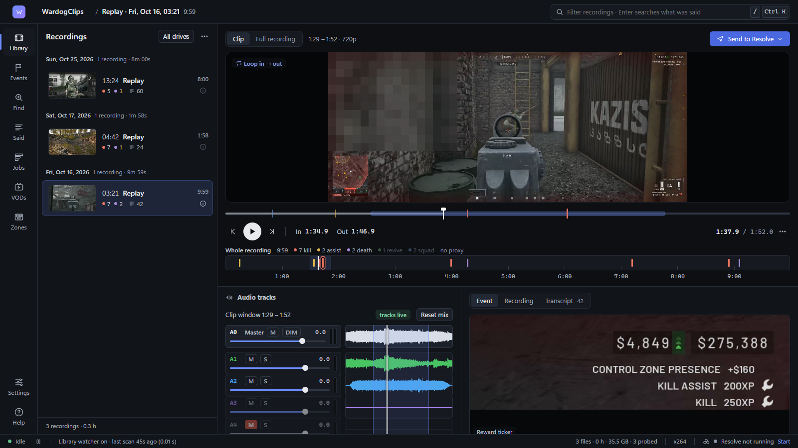
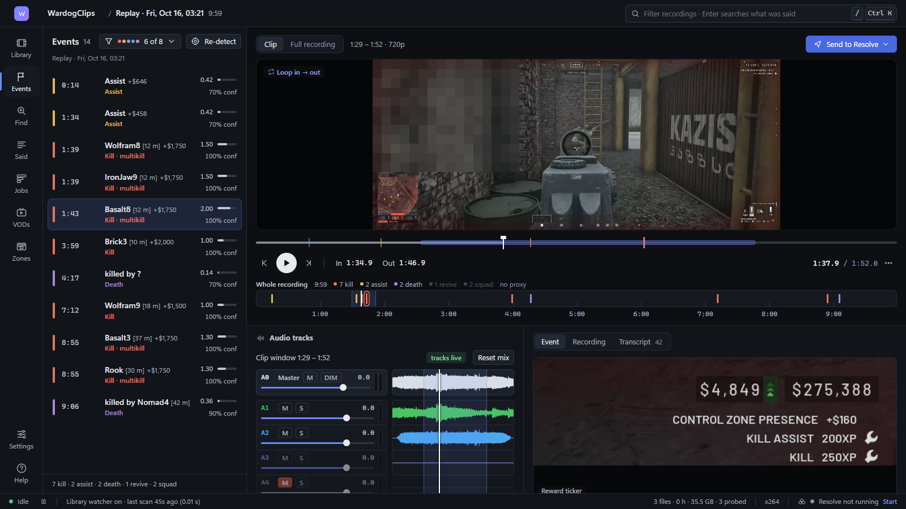
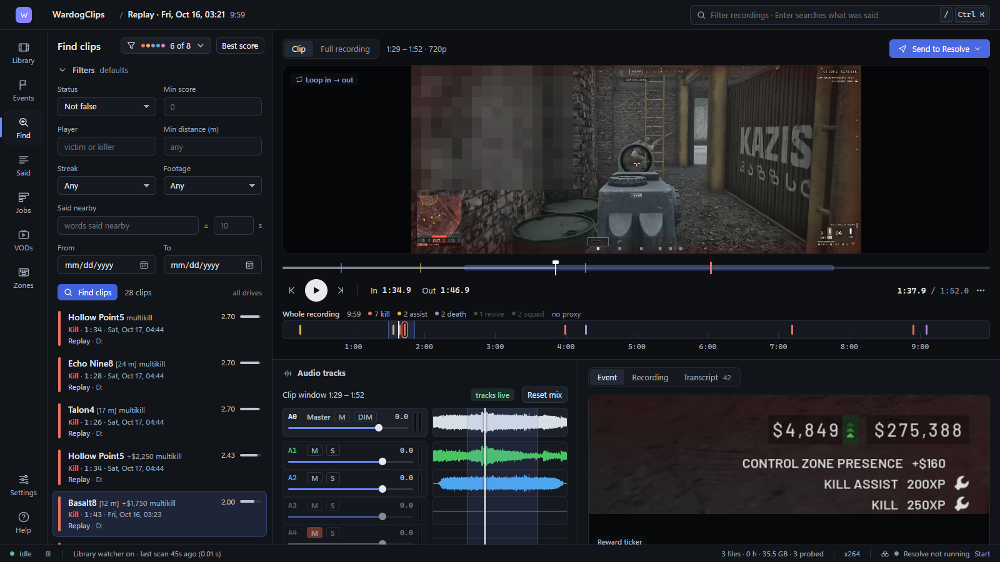
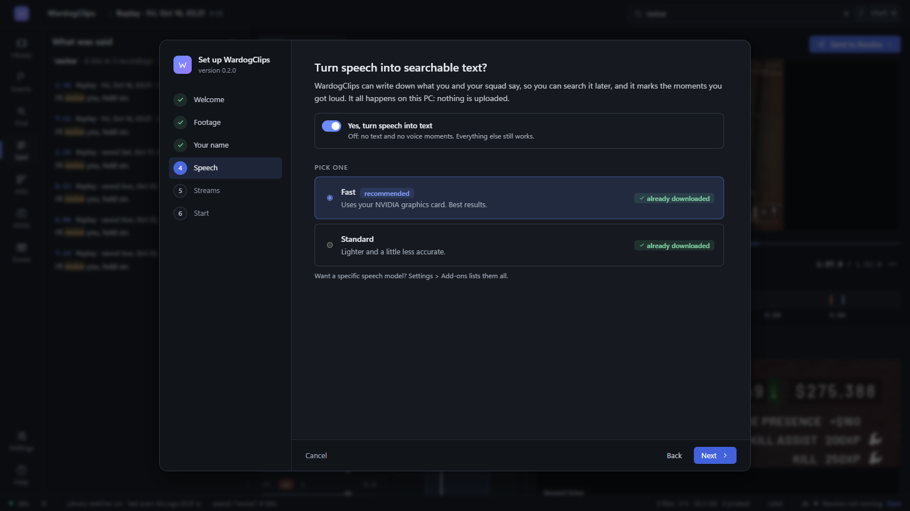

# WardogClips

Find the moments worth cutting in your WARDOGS recordings without scrubbing through hours of footage.

WardogClips looks through the videos OBS saves and finds your **kills, kill assists, deaths and voice highlights**
(the moments you and your squad got loud, or said a word you care about). It writes down what was said on your mic and
on Discord so you can search it, plays every moment as a short clip, and hands the ones you keep to **DaVinci Resolve**
as clip markers or a ready-made selects timeline. It can also download **stream recordings (VODs)** from YouTube,
Twitch, Kick, TikTok and Rumble, and find the moments in those.

Everything runs on your own PC.



<table>
<tr>
<td width="33%"></td>
<td width="33%"></td>
<td width="33%"></td>
</tr>
<tr>
<td align="center"><b>Events</b>: every kill, assist and death in a recording</td>
<td align="center"><b>Find clips</b>: search the whole library</td>
<td align="center"><b>First-run setup</b>: a few plain questions</td>
</tr>
</table>

<sub>Screenshots use demo data: player names are invented and other players' names in the game footage are blurred.</sub>

## Requirements

- Windows 10 or 11, 64-bit.
- OBS recordings (or replays) of WARDOGS, at any resolution. Detection was built for the Season 2 HUD at 3440x1440
  and scales by the video's height; for footage with a different layout you can redraw the detection boxes in
  **Zones**.
- An NVIDIA graphics card is optional: it makes speech-to-text much faster. Without one, speech runs on the
  processor (slower, still works).
- About 750 MB of disk for the program (a 165 MB download), plus what you choose to download: the speech engine
  for NVIDIA cards (about 1.3 GB), a speech model (75 MB to 3.1 GB) and any stream VODs. Clips and previews the app
  makes for its player are kept in its data folder too.
- DaVinci Resolve is optional, only for sending clips to it. Tested with DaVinci Resolve Studio 21; the free version
  has not been tested.

## Install

1. Download `WardogClips-Setup-0.2.0.exe` from the [Releases](../../releases) page.
2. Run it. No admin rights are needed; it installs for your Windows user only, into
   `%LOCALAPPDATA%\Programs\WardogClips`.
3. **Windows SmartScreen will warn you** ("Windows protected your PC"), because the installer is not code-signed.
   Click **More info**, then **Run anyway**. You can check the download against the `.sha256` file on the release
   page first if you like.

The installer brings everything it needs (its own Python, FFmpeg, the Visual C++ runtime). Nothing is added to your
PATH and nothing system-wide is changed.

## First run

The first time it starts, a short setup opens in your browser:

1. **Welcome** - what WardogClips does and what it found on this PC (graphics card, OBS, Resolve).
2. **Footage** - the folders OBS saves your recordings in (read from your OBS settings and ticked for you); add
   others with **Add folder...** or skip and add them later.
3. **Your name** - your in-game name (as the kill feed shows it, without a clan tag) and, optionally, your squad
   mates, so your kills are told apart from everyone else's.
4. **Speech** - turn speech into searchable text or not, and pick **Fast** (NVIDIA cards only, about 2.8 GB one-time
   download; less on cards with under 6 GB of memory), **Standard** (about 480 MB) or **Light** (about 75 MB, only
   offered without an NVIDIA card). The setup shows the exact size for your PC.
5. **Streams** - whether you also want to download stream VODs, and where to save them (default:
   `Videos\WardogClips VODs`). YouTube may need a small helper (about 41 MB) that downloads with the rest.
6. **Start** - a summary; press Start and WardogClips begins looking through your footage. Downloads keep running
   while you use the app.

Every answer can be changed later in **Settings**; **Settings > Add-ons > Run setup again** shows the questions again.

## Everyday use

- Start **WardogClips** from the Start menu (or the desktop icon, if you ticked it during install). There is no
  console window: a **tray icon** appears
  next to the clock and the app opens in your browser at `http://127.0.0.1:8558` (the next free port if 8558 is
  taken).
- Closing the browser tab does not stop WardogClips. Right-click the tray icon for **Open WardogClips**, **Open data
  folder**, **Open log** and **Quit**. Starting it again while it runs just reopens the page.
- New recordings are picked up while the app runs. Each one is checked, transcribed and scanned for kills / deaths in
  the background; the status bar shows what is running.
- **Events** lists what was found. Click one to play it; **Y** keeps it, **X** marks it a false
  positive. **Find** searches clips (kind, player, distance, streaks, what was said); **Said** searches the
  transcripts.
- Send the clips you kept to Resolve as **markers** (on the clip in the media pool) or as a **selects** timeline, or
  export a CSV / EDL.
- **Premiere Pro / other editors (experimental):** the same panel exports a Premiere XML (File > Import in Premiere;
  FCP 7 XML, which DaVinci Resolve and Final Cut Pro 7 tools also read) or an OpenTimelineIO `.otio` file, with
  every audio track of the recording on its own track and a marker per event. Not yet tested in Premiere or
  Resolve -- please report how the import goes.
- **VODs** in the left rail: paste a stream link, or search a streamer and pick VODs to import.
- **Ctrl+K** opens a command list with every action; **?** shows the keyboard shortcuts.

## Updating

Download the newer Setup and run it. If WardogClips is running, the installer asks it to quit first, then replaces the
program files. Your library, events, settings, downloaded add-ons and speech models are kept.

**Settings > Updates** can check GitHub for a newer release (at most once a day, nothing is downloaded). It stays off
until a repository is filled in there.

## Uninstalling

Windows **Settings > Apps > Installed apps** (Windows 10: **Apps & features**) **> WardogClips > Uninstall**. The
uninstaller stops WardogClips if it runs, asks whether to also delete your WardogClips data (database, caches,
add-ons in `%LOCALAPPDATA%\WardogClips`), then removes the program. The answer defaults to **No**.

Always kept:

- your recordings (WardogClips never changes them),
- downloaded stream VODs (in the folder you chose, default `Videos\WardogClips VODs`),
- speech models, which live in the shared Hugging Face cache (`%USERPROFILE%\.cache\huggingface\hub`, or
  `%HF_HOME%\hub` if you set `HF_HOME`) that other programs may use too. Delete the `models--*faster-whisper-*` folders there yourself if you no longer
  need them.

## Privacy and safety

**Does anything leave my PC?** No recordings, transcripts or clips are ever uploaded. Speech-to-text and the HUD text
reading run locally; there is no cloud AI and no telemetry. WardogClips only goes online when you ask it to:

- add-on and speech model downloads you start (only from PyPI, GitHub and Hugging Face and their download servers);
  if speech is on and the speech model you picked is not downloaded yet, it is fetched from Hugging Face the first
  time a recording is transcribed,
- stream VOD lookups and imports (the site you picked),
- the optional release check against GitHub (off until you set a repository in Settings > Updates).

The web page is served on `127.0.0.1` only (by default), and the app refuses requests from other websites (cross-site requests
and DNS-rebinding tricks are blocked).

**Can this get me banned? Is it safe with anti-cheat?** WardogClips never opens, reads, injects into or even looks for
the game process, and never touches the game's or Steam's files. It only reads video files OBS has already written,
read-only, after the fact (plus OBS's own settings file, read-only, to find your recording folders and track
names). All its own files (database, caches, clips) go to `%LOCALAPPDATA%\WardogClips`.

**Does it change my recordings?** No. They are read in place and never written to, moved or renamed.

## Troubleshooting

- **Where is the log?** Right-click the tray icon > **Open log**, or open
  `%LOCALAPPDATA%\WardogClips\logs\wardogclips.log` (a new file each day, 14 days kept).
- **The page does not open / port busy.** If another program holds port 8558, WardogClips uses the next free one (up
  to 8578) and the tray's **Open WardogClips** goes to the right one. Starting WardogClips again also reopens the
  page of the running copy.
- **"WardogClips is damaged"** - program files are missing (often an antivirus removed one). Reinstall.
- **Antivirus warning or quarantine.** The launcher and installer are not code-signed, and some antivirus products
  flag unsigned programs that start Python from `AppData`. Check the installer against the `.sha256` on the release
  page, restore the file and allow `%LOCALAPPDATA%\Programs\WardogClips`, or report it to your antivirus vendor as a
  false positive.
- **Resolve says it cannot connect.** In DaVinci Resolve, open **Preferences > System > General** and set
  **External scripting using** to **Local**, then restart Resolve. Resolve must be running with a project open (if
  it is not, WardogClips can start it and waits for you to open a project). If Resolve's own script server failed to
  start, the app says so: close Resolve and open it again.
- **Speech-to-text is slow.** Without the NVIDIA speech engine it runs on the processor. If you have an NVIDIA card,
  install **Speech engine for your graphics card** in **Settings > Add-ons**.
- **Stream downloads stopped working.** Sites change; **Settings > Add-ons > Update VOD downloader** fetches a newer
  downloader.

## Running from source

The installer is the supported way to run WardogClips. To run the code directly you need Windows, Python 3.13
(64-bit) and FFmpeg on your PATH:

```
py -3.13 -m venv venv
venv\Scripts\python.exe -m pip install -r requirements-runtime.txt
venv\Scripts\python.exe main.py
```

## License

WardogClips is released under the [MIT License](LICENSE). It ships and downloads third-party software (Python,
FFmpeg, the Visual C++ runtime, faster-whisper, RapidOCR, yt-dlp, NVIDIA's CUDA libraries, Whisper models and more)
under their own licenses (the bundled FFmpeg is GPL-3.0; its license text is installed in `vendor\ffmpeg`): see
[THIRD_PARTY_NOTICES.md](THIRD_PARTY_NOTICES.md).

WardogClips is not affiliated with the makers of WARDOGS, OBS Studio or DaVinci Resolve.
